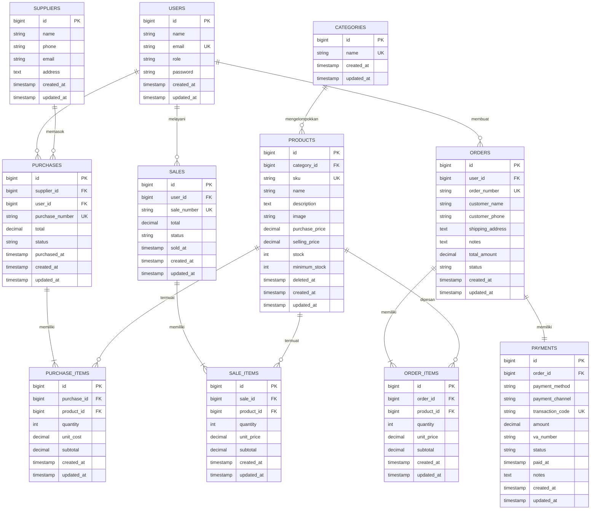

# DOKUMENTASI LENGKAP PENJELASAN PER FILE (UTS PEMROGRAMAN WEB)
> **Proyek:** Apex Outfitter POS & Outdoor Gear Inventory Management System  
> **Tujuan:** Panduan penjelasan kode untuk presentasi, ujian, dan penilaian dosen secara mendalam.

---

## 1. ROUTES (Rute Navigasi Web)

### `routes/web.php`
- **Fungsi Utama:** Mendefinisikan seluruh titik akhir (*endpoints*) URL aplikasi web, middleware otorisasi, dan pemetaan ke Controller yang bersangkutan.
- **Rincian Bagian:**
  1. **Route Publik & Redireksi Awal (`/`):** Mengecek status login user. Jika admin/staff diarahkan ke `/dashboard`, jika umum/customer diarahkan ke `/shop`.
  2. **Katalog Alat Outdoor (`/shop`, `/shop/{product}`):** Dapat diakses publik untuk melihat daftar perlengkapan gunung dan detail spesifikasi teknisnya.
  3. **Grup Route Customer (`auth` middleware):**
     - Keranjang Belanja: `GET /cart`, `POST /cart/add/{product}`, `PUT /cart/update/{product}`, `DELETE /cart/remove/{product}`, `POST /cart/clear`.
     - Checkout & Transaksi: `GET /checkout`, `POST /checkout`.
     - Payment Gateway: `GET /payment/{order}`, `POST /payment/{order}/simulate-pay`.
     - Riwayat & Laporan: `GET /customer/orders`, `GET /customer/orders/{order}`, `GET /customer/reports`.
  4. **Grup Route Backoffice Admin & Staff (`auth` middleware):**
     - Dashboard (`/dashboard`), Katalog internal (`/products`).
     - Kasir POS (`/sales` resource).
     - Pembelian Pasokan Stok Masuk (`/purchases` resource).
     - Manajemen Pesanan Toko (`/admin/orders`, `/admin/orders/{order}`, update status).
     - Pusat Laporan Keuangan Bisnis (`/reports`).
  5. **Grup Route Khusus Owner / Administrator (`can:admin-only` gate):**
     - Pembatalan Transaksi Kasir POS (`POST /sales/{sale}/cancel`).
     - Pembatalan Pesanan Online Pelanggan (`POST /payment/{order}/cancel` atau via status update).
     - Modifikasi produk (tambah, edit, hapus).
     - CRUD Kategori (`/categories`), Supplier (`/suppliers`), dan Pengguna (`/users`).

---

## 2. CONFIGURATION & SERVICE PROVIDERS

### `app/Providers/AppServiceProvider.php`
- **Fungsi Utama:** Mendefinisikan aturan otorisasi server-side (*Gate authorization*) untuk memastikan pemisahan hak akses antar role:
  - Gate `admin-only`: Memeriksa apakah role user adalah `'admin'`.
  - Gate `staff-or-admin`: Memeriksa apakah role user adalah `'admin'` atau `'staff'`.
  - Gate `customer-only`: Memeriksa apakah role user adalah `'customer'`.

---

## 3. DATABASE MIGRATIONS (Struktur Tabel Database MariaDB)

### `database/migrations/0001_01_01_000000_create_users_table.php`
- **Fungsi:** Membuat tabel `users` bawaan Laravel dengan kolom `name`, `email`, `password`, dan token otentikasi.

### `database/migrations/2026_01_01_000000_create_inventory_tables.php`
- **Fungsi:** Membuat fondasi tabel utama inventaris dan POS:
  1. Menambahkan kolom `role` (enum: `'admin'`, `'staff'`, `'customer'`, default `'customer'`) pada tabel `users`.
  2. Tabel `categories`: Menyimpan master kategori produk (`id`, `name`, timestamps).
  3. Tabel `suppliers`: Menyimpan data rekanan pemasok barang (`id`, `name`, `phone`, `email`, `address`).
  4. Tabel `products`: Menyimpan katalog barang dengan `category_id`, `sku` (unik), `name`, `description`, `purchase_price` (modal), `selling_price` (harga jual), `stock`, `minimum_stock` (batas peringatan), serta `deleted_at` (*Soft Deletes* agar transaksi lama tidak rusak saat produk dihapus).
  5. Tabel `purchases` & `purchase_items`: Menyimpan transaksi pasokan stok masuk dari supplier (*Stock-In*).
  6. Tabel `sales` & `sale_items`: Menyimpan transaksi kasir fisik langsung (*POS Stock-Out*).

### `database/migrations/2026_01_02_000000_create_orders_and_payments_tables.php`
- **Fungsi:** Menambahkan tabel untuk transaksi belanja online customer dan payment gateway:
  1. Tabel `orders`: Menyimpan pesanan toko (`user_id`, `order_number`, `customer_name`, `customer_phone`, `shipping_address`, `notes`, `total_amount`, `status` [pending_payment, paid, processing, completed, cancelled]).
  2. Tabel `order_items`: Menyimpan rincian produk dalam pesanan, jumlah kuantitas, harga satuan dari DB, dan subtotal.
  3. Tabel `payments`: Menyimpan riwayat transaksi pembayaran gateway (`order_id`, `payment_method`, `payment_channel`, `transaction_code`, `amount`, `va_number`, `status` [pending, success, failed, expired], `paid_at`).

---

### 🗄️ ENTITY-RELATIONSHIP DIAGRAM (ERD DATABASE)

Berikut visualisasi diagram hubungan antar entitas (ERD) 11 tabel dalam sistem Apex Outfitter:

---

## 4. ELOQUENT MODELS (Pemodelan Objek & Relasi Database)

### `app/Models/User.php`
- **Fungsi:** Representasi entitas pengguna. Memiliki atribut `$fillable` (`name`, `email`, `password`, `role`), fungsi pemeriksa role (`isAdmin()`, `isStaff()`, `isCustomer()`), dan relasi `hasMany` ke `Order`, `Sale`, serta `Purchase`.

### `app/Models/Product.php`
- **Fungsi:** Representasi produk barang. Menggunakan trait `SoftDeletes`. Menghubungkan produk ke `Category` (`belongsTo`), `SaleItem`, `PurchaseItem`, dan `OrderItem` (`hasMany`).

### `app/Models/Category.php`
- **Fungsi:** Representasi kelompok produk. Memiliki relasi `hasMany` ke `Product`.

### `app/Models/Supplier.php`
- **Fungsi:** Representasi vendor pemasok stok. Memiliki relasi `hasMany` ke `Purchase`.

### `app/Models/Sale.php` & `app/Models/SaleItem.php`
- **Fungsi:** Relasi transaksi kasir POS. `Sale` mencatat nomor penjualan, kasir yang bertugas, dan total pembayaran. `SaleItem` mencatat setiap produk yang dibeli dan mengaitkannya dengan `Product` menggunakan `withTrashed()`.

### `app/Models/Purchase.php` & `app/Models/PurchaseItem.php`
- **Fungsi:** Relasi pembelian stok masuk dari supplier. Memperbarui kuantitas inventaris secara otomatis saat dicatat.

### `app/Models/Order.php` & `app/Models/OrderItem.php`
- **Fungsi:** Representasi pesanan toko online pelanggan. `Order` memiliki relasi `hasOne(Payment::class)` dan `hasMany(OrderItem::class)`, serta accessor `getStatusBadgeAttribute()` untuk merender badge warna status transaksi secara seragam.

### `app/Models/Payment.php`
- **Fungsi:** Representasi transaksi gateway pembayaran. Mencatat channel (QRIS, VA BCA/Mandiri, E-Wallet), kode transaksi unik, nominal, status sukses/pending, dan waktu lunas `paid_at`.

---

## 5. CONTROLLERS (Logika Bisnis & Penanganan Request)

### Bagian Customer & Payment Gateway:

#### `app/Http/Controllers/Customer/StoreController.php`
- **`index()`:** Mengambil produk dari database dengan fitur filter kategori, pencarian multi-kolom (*name, sku, description*), dan pengurutan harga/abjad. Hasil dipaginate secara dinamis.
- **`show()`:** Menampilkan detail spesifikasi produk tunggal beserta daftar produk serupa dalam kategori yang sama.

#### `app/Http/Controllers/Customer/CartController.php`
- **`index()`:** Menampilkan keranjang belanja. **Kunci Keamanan:** Mengambil harga dan memeriksa ketersediaan stok *fresh* langsung dari database server, bukan dari input browser.
- **`add()`:** Menambahkan barang ke keranjang belanja session dengan validasi batas stok maksimum.
- **`update()`:** Memperbarui kuantitas item di keranjang dengan pengecekan stok gudang.
- **`remove()` & `clear()`:** Menghapus satu atau seluruh barang dari keranjang belanja.

#### `app/Http/Controllers/Customer/CheckoutController.php`
- **`index()`:** Menampilkan formulir checkout dan kalkulasi total belanja resmi dari database.
- **`process()`:** Melakukan validasi ketat formulir pengiriman (nama, telepon, alamat, metode pembayaran). Menjalankan `DB::transaction`:
  1. Mengunci baris produk dengan `lockForUpdate()` untuk mencegah *race condition*.
  2. Mengambil harga satuan asli dari server `selling_price` (mencegah *Price Tampering*).
  3. Membuat record `Order` (status: `pending_payment`) dan `OrderItem`.
  4. Menghasilkan nomor Virtual Account unik atau kode QRIS sesuai channel bank.
  5. Membuat record `Payment` berstatus `pending` dan mengosongkan keranjang belanja.
  6. Mengarahkan pelanggan ke antarmuka Payment Gateway.

#### `app/Http/Controllers/Customer/PaymentController.php`
- **`show()`:** Menampilkan halaman **LaraPay Gateway Simulator** lengkap dengan QRIS interaktif, nomor Virtual Account, dan petunjuk transfer.
- **`simulatePay()`:** Menangani simulasi pelunasan pembayaran instan (*Mock Webhook Gateway*). Menjalankan transaksi database atomik:
  1. Mengunci produk via `lockForUpdate()`.
  2. Memverifikasi ketersediaan stok kembali.
  3. **Mengurangi stok produk secara resmi:** `$product->decrement('stock', $item->quantity)`.
  4. Memperbarui status pembayaran menjadi `success` dan status order menjadi `paid`.
  5. Menerbitkan struk/invoice pelunasan digital.
- **`cancel()`:** Membatalkan pesanan. Jika pesanan sudah sempat dibayar, stok barang dikembalikan secara otomatis ke gudang (*stock return*).

#### `app/Http/Controllers/Customer/OrderController.php`
- **`index()`:** Menampilkan riwayat transaksi belanja pelanggan dengan tab status (*Semua, Menunggu Bayar, Dibayar, Selesai, Dibatalkan*).
- **`show()`:** Menampilkan faktur/invoice digital lengkap untuk dicetak atau disimpan pelanggan.
- **`reports()`:** Menghasilkan laporan pengeluaran belanja pelanggan dengan filter tanggal, total dana yang dibelanjakan, jumlah item yang dibeli, dan produk favorit.

---

### Bagian Admin & Inventaris Backoffice:

#### `app/Http/Controllers/DashboardController.php`
- **Fungsi:** Menggabungkan data analitik bisnis menyeluruh:
  - Jika user ber-role `customer`, otomatis dialihkan ke portal toko `/shop`.
  - Menghitung omset POS dan Pesanan Online (harian & bulanan).
  - Mengambil daftar produk yang berada di bawah batas minimum stok (`whereColumn('stock', '<=', 'minimum_stock')`).
  - Menyiapkan data grafik Chart.js dan riwayat transaksi terbaru.

#### `app/Http/Controllers/Admin/OrderManagementController.php`
- **`index()`:** Menampilkan seluruh pesanan online yang masuk dari customer beserta ringkasan status.
- **`show()`:** Menampilkan rincian pesanan dan informasi pembayaran untuk admin/staff.
- **`updateStatus()`:** Mengizinkan admin memperbarui status pesanan menjadi `processing`, `completed`, atau `cancelled` (dengan pengembalian stok jika dibatalkan).

#### `app/Http/Controllers/Admin/ReportController.php`
- **Fungsi:** Pusat pelaporan keuangan dan inventaris terpadu:
  - Menghitung Total Omset POS Kasir dan Toko Online.
  - Menghitung Total Pengeluaran Pembelian Stok Modal.
  - Menghitung Estimasi Laba Kotor (*Gross Profit = Omset - Modal Masuk*).
  - Menghitung Total Nilai Aset Gudang (*Stock x Purchase Price*).
  - Menyediakan mode cetak ramah cetak (`?print=1`) untuk pengumpulan laporan UTS fisik/PDF.

#### `app/Http/Controllers/ProductController.php`
- **Fungsi:** Pengelolaan master produk inventaris (katalog, penambahan produk baru dengan SKU unik, edit spesifikasi dan harga, serta soft delete produk).

#### `app/Http/Controllers/SaleController.php`
- **Fungsi:** Operasional kasir POS toko fisik. Menerima multi-item input belanja, mengunci baris produk di database, memotong stok gudang, dan menerbitkan struk kasir.

#### `app/Http/Controllers/PurchaseController.php`
- **Fungsi:** Pasokan stok masuk (*Stock-In*). Menghubungkan pengadaan barang dengan data supplier, menghitung total modal pembelian, dan menambah stok produk secara otomatis (`$product->increment('stock', $qty)`).

#### `app/Http/Controllers/CategoryController.php`, `SupplierController.php`, `UserController.php`
- **Fungsi:** Manajemen data master pendukung (kategori barang, data rekanan supplier, dan registrasi akun staff/admin/customer).

---

## 6. BLADE VIEWS (Antarmuka Pengguna / User Interface)

### Master Layouts:
1. **`resources/views/layouts/app.blade.php`:**
   - Layout khusus panel Admin & Staff.
   - Dilengkapi navigasi atas dengan indikator role, menu master data, pintasan kasir cepat, notifikasi alert interaktif Alpine.js, dan Chart.js library.
2. **`resources/views/layouts/customer.blade.php`:**
   - Layout khusus pelanggan (Customer Portal).
   - Dilengkapi bilah pengumuman resmi, navigasi toko, counter keranjang belanja realtime (*Cart Badge*), menu akun pelanggan, dan garansi layanan belanja.

### Halaman Pelanggan (Customer Views):
1. **`customer/store/index.blade.php`:** Katalog toko modern dengan hero banner, filter kategori, search bar, kartu produk dengan badge stok dinamis, dan tombol beli instan.
2. **`customer/store/show.blade.php`:** Halaman rincian spesifikasi barang, jaminan garansi, pemilih jumlah kuantitas, dan rekomendasi produk terkait.
3. **`customer/cart/index.blade.php`:** Tabel keranjang belanja interaktif dengan form penyesuaian kuantitas, subtotal, tombol kosongkan keranjang, dan ringkasan tagihan.
4. **`customer/checkout/index.blade.php`:** Formulir pengiriman penerima terstruktur dan pemilih channel pembayaran digital (QRIS, VA Bank BCA/Mandiri/BNI/BRI, E-Wallet).
5. **`customer/payment/show.blade.php`:** **LaraPay Gateway Simulator** dengan QR code SVG dinamis, nomor VA dengan fitur salin satu klik, countdown timer 15 menit, dan tombol simulasi pelunasan instan.
6. **`customer/orders/index.blade.php`:** Riwayat transaksi belanja dengan tab filter status dan akses ke invoice.
7. **`customer/orders/show.blade.php`:** Faktur / struk pembelian digital resmi dengan format ramah cetak (`window.print()`).
8. **`customer/reports/index.blade.php`:** Laporan pengeluaran dan barang yang telah dibeli pelanggan dilengkapi filter tanggal.

### Halaman Manajemen & Laporan (Admin & Staff Views):
1. **`dashboard.blade.php`:** Dashboard eksekutif dengan kartu metrik omset, grafik perbandingan penjualan donat Chart.js, peringatan stok kritis, dan aktivitas kasir terbaru.
2. **`admin/orders/index.blade.php` & `show.blade.php`:** Panel manajemen pesanan online customer dan formulir pembaruan status logistik pengiriman.
3. **`admin/reports/index.blade.php`:** Pusat laporan analitik bisnis dengan tab interaktif untuk Penjualan POS, Pesanan Online, Pembelian Supplier, dan Analisis Margin Keuntungan.
4. **`admin/reports/print.blade.php`:** Dokumen laporan resmi siap cetak ke format PDF/kertas lengkap dengan kop universitas, tabel rekapitulasi, dan kolom tanda tangan dosen penilai UTS.
5. **`products/*`, `sales/*`, `purchases/*`, `categories/*`, `suppliers/*`, `users/*`:** Antarmuka master data dan operasional kasir fisik dengan gaya antarmuka Tailwind CSS modern.

---

## 7. DATABASE SEEDER

### `database/seeders/DatabaseSeeder.php`
- **Fungsi:** Mengisi database awal secara otomatis saat perintah `php artisan migrate:fresh --seed` dijalankan:
  1. Akun **Admin** (`admin@mail.com`), **Staff Kasir** (`staff@mail.com`), dan **Customer** (`customer@mail.com`).
  2. 4 Kategori Produk (Elektronik, Aksesoris Komputer, Peralatan Kantor, Gaming Gear).
  3. 2 Rekanan Supplier Pemasok Resmi.
  4. 6 Data Produk Master lengkap dengan SKU, harga beli modal, harga jual, stok, dan deskripsi.
  5. Sampel transaksi kasir POS dan sampel pesanan online customer dengan status lunas via QRIS agar sistem langsung memiliki data awal yang kaya untuk keperluan demo presentasi UTS.
