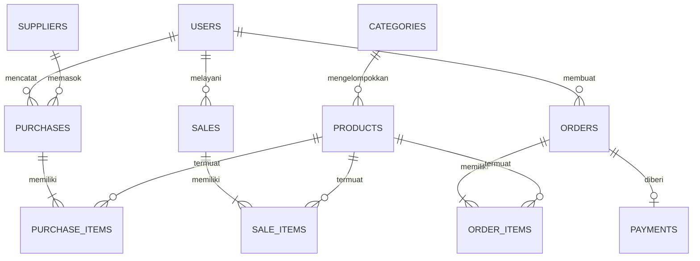

# Apex Outfitter — Outdoor Gear & Expedition Management System

[](https://laravel.com)
[](https://php.net)
[](https://mariadb.org)
[](https://tailwindcss.com)

> **Proyek Ujian Tengah Semester (UTS) Individu — Pemrograman Web Terintegrasi**  
> Sistem Informasi Inventaris Gudang, Kasir Point of Sale (POS) Toko Fisik, dan E-Commerce Peralatan Outdoor dengan Simulasi Payment Gateway Digital (QRIS & Virtual Account) serta Kontrol Transaksi Berbasis Peran.

---

## 1. Project Overview (Ringkasan Proyek)

**Apex Outfitter** adalah sistem aplikasi web berbasis Laravel 12 yang dirancang khusus untuk operasional bisnis retail perlengkapan petualangan alam, pendakian gunung, dan camping (seperti tenda dome, carrier/ransel gunung, sepatu trekking, jaket hardshell waterproof, sleeping bag, kompor portable, hingga peralatan survival).

Sistem ini mengintegrasikan dua portal utama dalam satu ekosistem terpadu:
1. **Portal Publik & E-Commerce Pelanggan (Customer Experience):**
   - Pengunjung umum dapat langsung menjelajahi katalog perlengkapan outdoor, melakukan pencarian, memfilter kategori, melihat detail spesifikasi alat, dan menambahkan barang ke keranjang belanja (*Shopping Cart*) tanpa harus login di awal.
   - Saat checkout, pelanggan dapat memasukkan data ekspedisi dan memilih metode pembayaran digital melalui **ApexPay Gateway** (QRIS resmi standar GPN dan Virtual Account Bank).
   - Pelanggan terdaftar memiliki akses ke riwayat pesanan, faktur digital (invoice cetak), serta laporan analisis pengeluaran belanja pribadi.

2. **Portal Backoffice & Kasir POS (Owner & Staff):**
   - Terminal kasir **Point of Sale (POS)** untuk melayani pembelian langsung di toko fisik secara cepat dengan pemotongan stok otomatis dan cetak struk nota.
   - Manajemen pasokan stok masuk (*Stock-In*) dari supplier resmi untuk menambah persediaan gudang.
   - Dashboard eksekutif dengan **grafik visual dinamis Chart.js** yang otomatis menghitung omset live, margin laba kotor, dan peringatan stok kritis.
   - Pusat laporan bisnis komprehensif yang siap dicetak ke format PDF.

Sistem menerapkan prinsip **Data Integrity** (keamanan transaksi atomik via database transactions dan penguncian stok) serta **Access Control** ketat berbasis 3 peran pengguna (**Owner**, **Staff**, dan **Customer**).

---

## 2. Requirements (Kebutuhan Sistem)

Sebelum menjalankan aplikasi, pastikan komputer/server Anda memenuhi spesifikasi berikut:

* **PHP:** Versi `>= 8.2`
  * Ekstensi PHP yang wajib aktif: `pdo`, `pdo_mysql`, `mbstring`, `openssl`, `tokenizer`, `xml`, `ctype`, `json`, `bcmath`, `curl`.
* **Database Server:** MySQL `>= 5.7` atau MariaDB `>= 10.4` (disediakan oleh **XAMPP**, WampServer, atau instalasi native).
* **Package Manager:** [Composer](https://getcomposer.org/) versi `>= 2.2`
* **Web Browser:** Google Chrome, Mozilla Firefox, Microsoft Edge, atau Safari modern.
* **Git:** Versi `>= 2.x` (untuk proses cloning dari GitHub).

---

## 3. Installation (Panduan Instalasi dari Repository Baru)

Ikuti langkah-langkah terstruktur berikut untuk memasang proyek dari repositori baru (*fresh clone*):

### Langkah 1: Clone Repositori
Buka terminal (Git Bash, Command Prompt, atau PowerShell), lalu clone repositori ke komputer Anda:
```bash
git clone https://github.com/USERNAME/REPOSITORY_NAME.git apexoutfitter
cd apexoutfitter
```

### Langkah 2: Install Dependensi PHP
Jalankan Composer untuk mengunduh seluruh dependensi framework Laravel:
```bash
composer install
```

### Langkah 3: Konfigurasi File Environment (`.env`)
Salin file konfigurasi contoh `.env.example` menjadi `.env`:
* **Di Windows (Command Prompt / PowerShell):**
  ```cmd
  copy .env.example .env
  ```
* **Di Linux / macOS / Git Bash:**
  ```bash
  cp .env.example .env
  ```

### Langkah 4: Generate Application Key
Buat kunci enkripsi unik aplikasi Laravel:
```bash
php artisan key:generate
```

---

## 4. Environment Setup (Pengaturan Database & Server)

1. Buka aplikasi **XAMPP Control Panel** dan klik **Start** pada modul **Apache** dan **MySQL**.
2. Buka browser dan akses **phpMyAdmin** di alamat `http://localhost/phpmyadmin`.
3. Buat database baru bernama **`inventory_uts`** (Collation: `utf8mb4_unicode_ci`).
4. Buka file `.env` di teks editor Anda, lalu pastikan parameter koneksi database sudah sesuai:
   ```env
   APP_NAME="Apex Outfitter"
   APP_ENV=local
   APP_KEY=base64:... (sudah terisi otomatis dari Langkah 4)
   APP_DEBUG=true
   APP_URL=http://localhost:8000

   DB_CONNECTION=mysql
   DB_HOST=127.0.0.1
   DB_PORT=3306
   DB_DATABASE=inventory_uts
   DB_USERNAME=root
   DB_PASSWORD=
   ```
   *(Catatan: Jika MySQL Anda menggunakan password, sesuaikan pada variabel `DB_PASSWORD`)*.

---

## 5. Migration & Seeding (Migrasi & Data Dummy Otomatis)

Jalankan perintah berikut di terminal untuk membangun seluruh 11 tabel database relasional beserta seluruh data awal (*seed data*):

```bash
php artisan migrate:fresh --seed
```

### Apa Saja yang Dibuat Otomatis oleh Seeder?
1. **5 Akun Pengguna:** 1 akun Owner/Admin, 1 akun Staff Kasir, dan 3 akun Customer (termasuk **Jack Kurniawan**).
2. **7 Kategori Produk Outdoor:** Tenda Gunung, Ransel & Carrier, Sepatu & Sandal, Pakaian & Jaket Gunung, Perlengkapan Tidur (Sleeping Bag & Matras), Alat Masak Outdoor, dan Aksesoris Ekspedisi.
3. **5 Supplier Resmi:** PT Eigerindo Multi Produk, Consina The Outdoor Lifestyle, Arei Outdoor Gear Indonesia, Deuter Indonesia Supply, dan The North Face Official Distr.
4. **16 Produk Master Peralatan Outdoor:** Dilengkapi foto resolusi tinggi yang akurat (tas carrier gunung, tenda dome, hiking boots kulit asli, kompor camping, dll.), harga beli modal, harga jual, dan stok awal.
5. **Data Transaksi Riil:** Riwayat transaksi penjualan POS kasir, pasokan stok supplier, pesanan online pelanggan, dan pembayaran digital otomatis terisi untuk menghasilkan grafik analitik Chart.js seketika.

---

## 6. Menjalankan Aplikasi Web

Anda dapat menjalankan server lokal dengan salah satu cara berikut:

### Opsi A: Melalui Script Otomatis (Windows)
Cukup **klik 2x (double click)** pada file:
```text
JALANKAN_APLIKASI.bat
```
Script ini akan langsung menyalakan server lokal Laravel di port 8000.

### Opsi B: Melalui Terminal / CLI
Jalankan perintah artisan standar:
```bash
php artisan serve --host=127.0.0.1 --port=8000
```

Buka peramban (browser) Anda dan akses alamat:
👉 **`http://127.0.0.1:8000`**

---

## 7. Demo Accounts & Hak Akses (Role Permissions)

Sistem telah dilengkapi 3 peran pengguna dengan kredensial pengujian yang siap didemonstrasikan di hadapan dosen/penguji:

| Peran (Role) | Nama Pengguna | Alamat Email | Kata Sandi | Halaman Utama (Redirect) | Hak Akses Utama |
| :--- | :--- | :--- | :--- | :--- | :--- |
| **Owner / Administrator** | Apex Owner & Admin | `admin@mail.com` | `password123` | `/dashboard` | **Kontrol Penuh:** Dashboard eksekutif, live chart laba/omset, kelola master data (produk, kategori, supplier, pengguna), cetak laporan laba rugi, dan **satu-satunya yang berhak membatalkan transaksi POS maupun online**. |
| **Staff Kasir & Gudang** | Staff Kasir Lapangan | `staff@mail.com` | `password123` | `/sales/create` | **Operasional Toko:** Melayani transaksi kasir POS toko fisik, input pasokan barang masuk gudang dari supplier, cek stok barang, dan proses packing/kirim pesanan online. *Tidak memiliki izin membatalkan transaksi dan tidak bisa mengelola pengguna.* |
| **Customer / Pelanggan** | Jack Kurniawan | `customer@mail.com` | `password123` | `/shop` | **Belanja Online:** Jelajah katalog outdoor, keranjang belanja (cart), checkout pengiriman, simulasi bayar QRIS & Virtual Account, riwayat pesanan, dan rekapitulasi pengeluaran pribadi. *Akses backoffice diblokir otomatis.* |

> **Registrasi Publik:** Pengunjung umum dapat mendaftar mandiri kapan saja melalui tombol **"Daftar Pelanggan Baru"** di halaman login (`/register`). Akun baru secara otomatis terdaftar sebagai `customer`.

---

## 8. Fitur-Fitur Utama Aplikasi (Features Breakdown)

### A. E-Commerce & Pengalaman Belanja Pelanggan
* **Katalog Alat Outdoor Dinamis:** Filter kategori instan, pencarian nama dan SKU, visualisasi ketersediaan stok, dan foto barang outdoor yang presisi.
* **Keranjang Belanja Realtime (Cart):** Multi-item shopping cart berbasis Session dengan validasi kuantitas stok otomatis.
* **Checkout Terstruktur:** Formulir alamat pengiriman, kontak penerima, catatan ekspedisi, dan pemilihan metode pembayaran digital.
* **Faktur & Struk Digital:** Tampilan invoice resmi ramah cetak (*print-friendly*) lengkap dengan nomor pesanan, rincian barang, dan status lunas.
* **Laporan Belanja Pelanggan:** Rekapitulasi total belanja customer, akumulasi unit barang, dan filter periode tanggal.

### B. Payment Gateway Simulator (ApexPay Gateway)
* **Keamanan Perhitungan Harga (Server-Side Calculation):** Harga produk diambil **100% dari database server** (`products.selling_price`), bukan dari browser/client, guna mencegah eksploitasi manipulasi harga (*Price Tampering*).
* **QRIS Standar Nasional (GPN):** Tampilan QR Code matrix dengan banner merah GPN, NMID resmi `ID1020268891024`, nama merchant **APEX OUTFITTER INDONESIA**, dan countdown timer hitung mundur 15 menit.
* **Virtual Account Bank (VA):** Generator kode pembayaran unik berbasis bank tujuan (BCA `8801...`, Mandiri `8902...`, BNI `8803...`, BRI `8804...`) dengan tombol salin nomor VA dan panduan m-Banking.
* **E-Wallet:** Dukungan pembayaran digital GoPay, OVO, dan DANA.
* **Simulasi Verifikasi Instan:** Tombol simulasi bayar yang memicu verifikasi lunas, mengunci stok dengan `Product::lockForUpdate()`, dan memotong stok gudang secara atomik.

### C. Alur Pembatalan Transaksi Eksklusif Owner
* Pembatalan transaksi penjualan kasir (POS) maupun pesanan online pelanggan **secara ketat hanya dapat dieksekusi oleh akun Owner / Administrator**.
* Staff kasir maupun customer tidak memiliki tombol pembatalan di tampilan mereka. Jika dilakukan bypass URL, server akan menolak dengan kode keamanan dan pesan: *"Akses ditolak: Pembatalan transaksi hanya dapat dilakukan oleh Owner / Administrator."*
* Saat transaksi dibatalkan oleh Owner, sistem secara otomatis mengembalikan stok barang ke gudang (`Product::increment('stock', $qty)`) dan memperbarui status pembayaran menjadi gagal melalui `DB::transaction()`.

### D. Kasir Point of Sale (POS) Toko Fisik
* Antarmuka kasir cepat untuk input transaksi langsung di toko outdoor.
* Fitur multi-item dinamis (tambah baris barang tanpa reload).
* Validasi ketersediaan stok seketika dan pencetakan bukti struk kasir toko.

### E. Pasokan Stok Masuk Gudang (Stock-In Purchases)
* Pencatatan barang masuk dari supplier resmi (Eiger, Consina, Arei, Deuter, TNF).
* Input kuantitas dan harga modal beli satuan (*unit cost*).
* Otomatis menambah jumlah stok inventaris produk terkait di database.

### F. Dashboard Eksekutif & Visualisasi Grafik (Chart.js)
* **Statistik Finansial:** Grand total omset gabungan (POS + Web), omset bulanan, dan estimasi laba kotor (*gross profit*).
* **Live Chart Donut:** Diagram visual interaktif yang membandingkan kontribusi pendapatan Kasir POS vs Toko Online secara otomatis dari database.
* **Peringatan Stok Kritis:** Tabel pemantauan produk dengan sisa stok &le; batas minimum stok untuk segera dipasok ulang.

### G. Pusat Laporan Bisnis Terpadu
* Filter rentang tanggal fleksibel (*date range*).
* Rekapitulasi Penjualan POS Kasir, Pesanan Toko Online, dan Pembelian Barang dari Supplier.
* Mode **Cetak Laporan Resmi / Simpan ke PDF** dengan tata letak kop surat standar perusahaan.

---

## 9. Data Integrity & Error Handling Architecture

Aplikasi dibangun dengan memperhatikan keandalan data (*Data Integrity*) dan penanganan galat (*Error Handling*) standar industri:

1. **Atomic Database Transactions:** Seluruh proses krusial (Checkout, Pelunasan Pembayaran, Kasir POS, Pasokan Gudang, dan Pembatalan Transaksi) dibungkus dalam blok `DB::transaction()`. Jika terjadi kegagalan sistem di tengah jalan, seluruh perubahan database akan di-rollback tanpa meninggalkan data yatim (*orphan records*).
2. **Pessimistic Locking (`lockForUpdate`):** Mencegah kondisi persaingan (*race conditions*) di mana dua pembeli membeli stok terakhir pada detik yang sama.
3. **Integritas Referensial Database (Foreign Key Constraints):**
   - Kategori tidak dapat dihapus jika masih menaungi produk aktif.
   - Supplier tidak dapat dihapus jika memiliki riwayat pengiriman stok.
   - Pengguna tidak dapat dihapus jika memiliki rekam jejak transaksi penjualan, pembelian, atau pesanan.
   - Admin tidak dapat menghapus akunnya sendiri yang sedang aktif digunakan.
4. **Validasi Formulir & Pesan Kesalahan Elegan:** Seluruh input divalidasi ketat di sisi server. Pesan kesalahan ditampilkan dalam bentuk kartu peringatan sistem yang ramah pengguna (*flash messages*), tanpa menimbulkan *crash* halaman atau *500 Internal Server Error*.
5. **Bebas dari Emoji Berlebih:** Antarmuka bersih, rapi, dan profesional menggunakan ikon vektor SVG modern.

---

## 10. Entity-Relationship Diagram (ERD)

Database `inventory_uts` terdiri atas **11 tabel relasional** yang saling berhubungan:



---

## 11. Known Limitations (Batasan Sistem)

* **Koneksi Gambar Produk:** Gambar katalog peralatan outdoor menggunakan CDN Unsplash resmi beresolusi tinggi. Diperlukan koneksi internet agar browser dapat merender gambar asli perlengkapan tersebut secara sempurna. Jika offline, browser akan menampilkan teks alt dan layout tetap rapi.
* **Simulasi Payment Gateway:** Modul ApexPay Gateway adalah simulator pembayaran digital untuk keperluan demonstrasi akademik (UTS), sehingga tidak melakukan pemotongan saldo rekening bank riil.
* **Hak Akses Pembatalan:** Kebijakan pembatalan transaksi sengaja dikunci secara mutlak hanya untuk Owner/Administrator demi memenuhi integritas audit stok inventaris toko.

---

## 12. Lisensi & Hak Cipta

Proyek ini dikembangkan secara independen sebagai tugas akhir **Ujian Tengah Semester (UTS) Mata Kuliah Pemrograman Web Terintegrasi**.  
Hak Cipta &copy; 2026 **Apex Outfitter Management System**. Seluruh hak dilindungi undang-undang.
