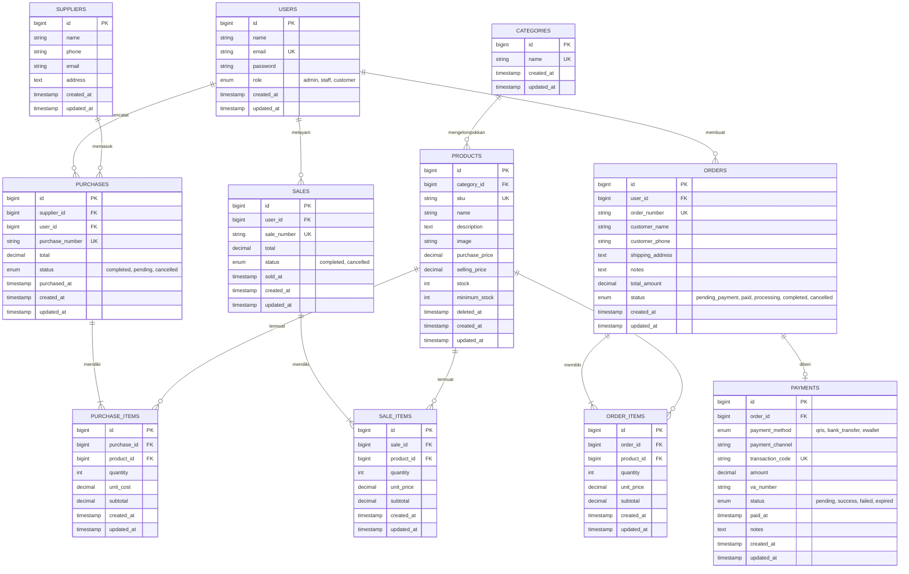

# Apex Outfitter — Outdoor Gear POS & Expedition Management System

[](https://laravel.com)
[](https://php.net)
[](https://mariadb.org)
[](https://tailwindcss.com)

> **Proyek Ujian Tengah Semester (UTS) Individu — Pemrograman Web Terintegrasi**  
> Sistem Manajemen Inventaris Gudang, Kasir Point of Sale (POS) Toko Fisik, dan E-Commerce Perlengkapan Outdoor dengan Simulasi Payment Gateway Digital (QRIS Nasional Standar GPN & Virtual Account Bank) serta Kontrol Transaksi Berbasis Peran.

---

## ⚡ PANDUAN CEPAT: MENJALANKAN APLIKASI DARI README

Anda dapat langsung menjalankan web ini di komputer Anda dengan salah satu dari dua cara berikut:

### Opsi 1: Cara Paling Cepat (1-Klik di Windows)
1. Buka aplikasi **XAMPP Control Panel**, pastikan modul **MySQL** dan **Apache** dalam status **Running (Aktif)**.
2. Di dalam folder utama proyek, **klik 2x (double-click)** pada file:
   ```text
   JALANKAN_APLIKASI.bat
   ```
3. Web server lokal akan otomatis menyala di port 8000.
4. Buka peramban (browser) Anda dan akses alamat:
   👉 **`http://127.0.0.1:8000`**

---

### Opsi 2: Instalasi Standar dari Repositori Baru (Fresh Clone)
Jalankan urutan perintah berikut di terminal (Command Prompt / PowerShell / Git Bash):

```bash
# 1. Masuk ke folder proyek
cd apexoutfitter

# 2. Unduh seluruh dependensi framework Laravel
composer install

# 3. Buat berkas environment (.env) dari contoh
copy .env.example .env    # Windows Command Prompt / PowerShell
# cp .env.example .env    # Linux / macOS / Git Bash

# 4. Generate Application Encryption Key unik
php artisan key:generate

# 5. Buat database baru bernama 'inventory_uts' di phpMyAdmin (http://localhost/phpmyadmin),
#    lalu jalankan migrasi tabel dan seeding data dummy otomatis:
php artisan migrate:fresh --seed

# 6. Jalankan development server lokal
php artisan serve --host=127.0.0.1 --port=8000
```
Buka browser dan buka: 👉 **`http://127.0.0.1:8000`**

---

## 🔑 KREDENSIAL AKUN PENGUJIAN (DEMO ACCOUNTS)

Sistem telah diisi data awal (*seeder*) otomatis sehingga siap diuji di hadapan penguji/dosen tanpa perlu input data manual dari awal:

| Peran (Role) | Nama Pengguna | Alamat Email | Kata Sandi | Halaman Utama (Redirect) | Hak Akses Utama |
| :--- | :--- | :--- | :--- | :--- | :--- |
| **👑 Owner / Administrator** | Apex Owner & Admin | `admin@mail.com` | `password123` | `/dashboard` | **Akses Penuh:** Dashboard eksekutif, live chart laba kotor & omset, kelola master data (produk, kategori, supplier, pengguna), cetak laporan laba rugi, dan **satu-satunya yang berhak membatalkan transaksi POS maupun online**. |
| **💼 Staff Kasir & Gudang** | Staff Kasir Lapangan | `staff@mail.com` | `password123` | `/sales/create` | **Operasional Toko:** Melayani kasir POS toko fisik, input pasokan stok gudang dari supplier, cek ketersediaan barang, dan proses packing/kirim pesanan online. *Dilarang membatalkan transaksi.* |
| **🎒 Customer / Pelanggan** | Jack Kurniawan | `customer@mail.com` | `password123` | `/shop` | **Belanja Online:** Jelajah katalog outdoor, keranjang belanja (cart), checkout alamat, simulasi bayar QRIS & Virtual Account, faktur struk belanja, dan rekapitulasi pengeluaran pribadi. *Akses backoffice diblokir otomatis.* |

> **Registrasi Publik:** Pengunjung umum dapat mendaftar mandiri kapan saja melalui tombol **"Daftar Pelanggan Baru"** di halaman login (`/register`). Akun baru secara otomatis terdaftar sebagai `customer`.

---

## 1. Project Overview (Ringkasan Proyek)

**Apex Outfitter** adalah sistem aplikasi web berbasis Laravel 12 yang dirancang khusus untuk operasional retail perlengkapan ekspedisi alam terbuka, pendakian gunung, dan camping (seperti tenda dome, carrier gunung, sepatu trekking, jaket hardshell waterproof, sleeping bag, kompor portable, hingga peralatan survival).

Sistem ini menggabungkan dua lingkungan operasional dalam satu platform terpadu:
1. **Portal Publik & Toko Online Pelanggan (Customer Experience):**
   - Pengunjung umum dapat langsung menjelajahi katalog perlengkapan outdoor, melakukan pencarian cerdas, memfilter kategori, melihat detail spesifikasi alat, dan menambahkan barang ke keranjang belanja (*Shopping Cart*) tanpa harus login di awal.
   - Saat checkout, pelanggan memasukkan data ekspedisi dan memilih metode pembayaran digital melalui **ApexPay Gateway** (QRIS resmi standar GPN dan Virtual Account Bank).
   - Pelanggan terdaftar memiliki akses ke riwayat pesanan, faktur digital (invoice cetak ramah printer), serta laporan analisis pengeluaran belanja pribadi.

2. **Portal Backoffice & Kasir POS (Owner & Staff):**
   - Terminal kasir **Point of Sale (POS)** untuk transaksi cepat di kasir toko fisik dengan pemotongan stok atomik dan cetak nota kasir.
   - Manajemen pasokan stok masuk (*Stock-In*) dari supplier resmi untuk menambah persediaan gudang.
   - Dashboard eksekutif dengan **grafik visual dinamis Chart.js** yang otomatis menghitung omset live, perbandingan penjualan POS vs Online, dan peringatan stok kritis.
   - Pusat laporan bisnis komprehensif yang siap dicetak ke format PDF.

---

## 2. Requirements (Kebutuhan Sistem)

Sebelum menjalankan aplikasi, pastikan komputer/server Anda memenuhi spesifikasi berikut:

* **PHP:** Versi `>= 8.2`
  * Ekstensi PHP wajib aktif: `pdo`, `pdo_mysql`, `mbstring`, `openssl`, `tokenizer`, `xml`, `ctype`, `json`, `bcmath`, `curl`.
* **Database Server:** MySQL `>= 5.7` atau MariaDB `>= 10.4` (disediakan oleh **XAMPP**, WampServer, atau instalasi native).
* **Package Manager:** [Composer](https://getcomposer.org/) versi `>= 2.2`
* **Web Browser:** Google Chrome, Mozilla Firefox, Microsoft Edge, atau Safari modern.
* **Git:** Versi `>= 2.x` (untuk proses cloning dari GitHub).

---

## 3. Environment Setup (Pengaturan Berkas `.env`)

Berkas `.env` mengatur konfigurasi koneksi database dan parameter sistem:

```env
APP_NAME="Apex Outfitter"
APP_ENV=local
APP_KEY=base64:... (dihasilkan oleh php artisan key:generate)
APP_DEBUG=true
APP_URL=http://localhost:8000

DB_CONNECTION=mysql
DB_HOST=127.0.0.1
DB_PORT=3306
DB_DATABASE=inventory_uts
DB_USERNAME=root
DB_PASSWORD=
```

---

## 4. Migration & Seeding (Struktur Data Dummy Otomatis)

Perintah `php artisan migrate:fresh --seed` membangun **11 tabel database relasional** beserta seluruh data awal:
* **7 Kategori Produk Outdoor:** Tenda Gunung, Ransel & Carrier, Sepatu & Sandal, Pakaian & Jaket Gunung, Perlengkapan Tidur (Sleeping Bag & Matras), Alat Masak Outdoor, dan Aksesoris Ekspedisi.
* **5 Supplier Resmi:** PT Eigerindo Multi Produk, Consina The Outdoor Lifestyle, Arei Outdoor Gear Indonesia, Deuter Indonesia Supply, dan The North Face Official Distr.
* **16 Produk Master Peralatan Outdoor:** Dilengkapi foto resolusi tinggi yang akurat (tas carrier gunung, tenda dome, hiking boots kulit asli, kompor camping, dll.), harga beli modal, harga jual, dan stok awal.
* **Data Transaksi Riil:** Riwayat transaksi penjualan POS kasir, pasokan stok supplier, pesanan online pelanggan, dan pembayaran digital otomatis terisi untuk menghasilkan grafik analitik Chart.js seketika.

---

## 5. Visual Tampilan Antarmuka Web (Dashboard & Transaksi)

Berikut gambaran struktur dan tata letak antarmuka halaman-halaman utama dalam sistem:

### A. Katalog & Toko Online Pelanggan (`/shop`)
```text
+--------------------------------------------------------------------------------------------------+
|  [LOGO] APEX OUTFITTER    Katalog Alat   Riwayat Pesanan   Laporan Belanja    [Keranjang: 2] [Jack]  |
+--------------------------------------------------------------------------------------------------+
|  [ HERO BANNER: PERLENGKAPAN GUNUNG, CAMPING & PETUALANGAN ALAM ]                                |
|  Menyediakan peralatan standar ekspedisi teruji dari supplier resmi. [Lihat Seluruh Katalog]     |
+--------------------------------------------------------------------------------------------------+
|  [Cari Nama / SKU: "Tenda"]   [Filter Kategori: Semua Outdoor V]   [Urutkan Harga V]             |
+--------------------------------------------------------------------------------------------------+
|  +--------------------+  +--------------------+  +--------------------+  +--------------------+  |
|  | [FOTO TENDA DOME]  |  | [FOTO CARRIER 65L] |  | [FOTO HIKING BOOT] |  | [FOTO SLEEPING BAG]|  |
|  | Tenda Dome Apex 4P |  | Carrier Highland   |  | Sepatu Alpine Mid  |  | Sleeping Bag Down  |  |
|  | Stok: 16 Unit      |  | Stok: 12 Unit      |  | Stok: 14 Unit      |  | Stok: 2 Unit (Low) |  |
|  | Rp 1.250.000       |  | Rp 980.000         |  | Rp 890.000         |  | Rp 790.000         |  |
|  | [+ Keranjang]      |  | [+ Keranjang]      |  | [+ Keranjang]      |  | [+ Keranjang]      |  |
|  +--------------------+  +--------------------+  +--------------------+  +--------------------+  |
+--------------------------------------------------------------------------------------------------+
```

### B. Simulasi Payment Gateway Digital ApexPay (`/payment/{order}`)
```text
+-----------------------------------------------------------------------------------+
|                            APEXPAY GATEWAY SIMULATOR                              |
|                       Portal Pembayaran Digital Terverifikasi                     |
+-----------------------------------------------------------------------------------+
|  [KIRI: METODE PEMBAYARAN]                  |  [KANAN: RINCIAN TAGIHAN PESANAN]   |
|                                             |                                     |
|  +---------------------------------------+  |  No. Pesanan: ORD-20261026-901     |
|  |  QRIS (STANDAR NASIONAL GPN)          |  |  Pelanggan  : Jack Kurniawan        |
|  |  NMID: ID1020268891024                |  |  Waktu Order: 26 Okt 2026, 18:30    |
|  |                                       |  |  Status     : MENUNGGU PEMBAYARAN   |
|  |      [  QR CODE MATRIX RESMI  ]       |  |                                     |
|  |      [     SCAN TO PAY        ]       |  |  Rincian Item:                      |
|  |                                       |  |  1. Tenda Apex Summit 4P (1x)       |
|  |  Sisa Waktu Bayar: [ 14:48 Menit ]    |  |  2. Kompor Gas FireStorm (1x)       |
|  |  Dukung: GoPay, OVO, DANA, BCA, BRI   |  |-------------------------------------|
|  +---------------------------------------+  |  Total Bayar: Rp 1.410.000          |
|                                             |                                     |
|  [✓ SIMULASIKAN PEMBAYARAN BERHASIL]        |  *Catatan: Pembatalan hanya berhak  |
|  (Mengunci stok & mengubah status PAID)     |   dilakukan oleh Owner toko.        |
+-----------------------------------------------------------------------------------+
```

### C. Struk Faktur Digital Pelanggan (`/customer/orders/{id}`)
```text
+-----------------------------------------------------------------------------------+
|                                  APEX OUTFITTER                                   |
|             Expedition Gear & Outdoor Lifestyle - Bukti Transaksi Resmi           |
|-----------------------------------------------------------------------------------|
| No. Invoice : ORD-20261026-901                    Tanggal  : 26 Oktober 2026      |
| Pembeli     : Jack Kurniawan (08123456789)        Metode   : ApexPay QRIS (GPN)   |
| Alamat      : Jl. Rinjani No. 12, Bandung         Status   : SUDAH LUNAS (PAID)   |
|-----------------------------------------------------------------------------------|
| No | Nama Perlengkapan Outdoor           | Qty | Harga Satuan  | Subtotal         |
|----+------------------------------------+-----+---------------+------------------|
| 1  | Tenda Dome Apex Summit 4P           | 1   | Rp 1.250.000  | Rp 1.250.000     |
| 2  | Kompor Camping FireStorm Windproof  | 1   | Rp   160.000  | Rp   160.000     |
|-----------------------------------------------------------------------------------|
|                                                    TOTAL AKHIR: Rp 1.410.000      |
|-----------------------------------------------------------------------------------|
| [🖨 CETAK FAKTUR BELANJA]                                      [← KEMBALI BELANJA] |
+-----------------------------------------------------------------------------------+
```

### D. Executive Dashboard Backoffice (`/dashboard`)
```text
+--------------------------------------------------------------------------------------------------+
|  [LOGO] APEX OUTFITTER   Dashboard   Katalog Alat   Kasir POS   Pasokan Stok   Pesanan   Laporan     |
|  Status: [OWNER / ADMINISTRATOR]                                              [admin@mail.com]   |
+--------------------------------------------------------------------------------------------------+
|  [ WELCOME OWNER: KONTROL PENUH & ANALITIK FINANSIAL ]  [+ Buka Kasir POS]  [+ Pasokan Masuk]    |
+--------------------------------------------------------------------------------------------------+
|  [ OMSET BULAN INI ]      [ ESTIMASI LABA KOTOR ]   [ TOTAL TRANSAKSI ]    [ STOK PERLU RESTOCK ] |
|  Rp 42.850.000            Rp 15.340.000             48 Transaksi           2 Produk Kritis        |
+--------------------------------------------------------------------------------------------------+
|  [ LIVE CHART.JS DONUT: DISTRIBUSI PENDAPATAN ]     | [ PERINGATAN STOK MENIPIS (CRITICAL) ]      |
|                                                     |                                             |
|        #### Kasir POS (68%)                         | 1. Sleeping Bag Goose Down : Sisa 2 (Min 3) |
|        #### Toko Online (32%)                       | 2. Ransel Daypack Boulder  : Sisa 3 (Min 5) |
|                                                     |                                             |
|  *Otomatis update live dari transaksi database!     | Tindakan: Segera input pasokan supplier!    |
+--------------------------------------------------------------------------------------------------+
```

### E. Terminal Kasir Point of Sale (`/sales/create`)
```text
+-----------------------------------------------------------------------------------+
|                        TERMINAL KASIR PENJUALAN LANGSUNG (POS)                    |
|                        Petugas: Staff Kasir Lapangan (staff@mail.com)             |
+-----------------------------------------------------------------------------------+
|  Daftar Item Belanja Kasir:                                                       |
|  [1] [Pilih Produk: Carrier Apex Highland 65L (Stok: 12) V]  [Qty: 1]  [Hapus]    |
|  [2] [Pilih Produk: Sandal Gunung TrailGrip (Stok: 28)    V]  [Qty: 2]  [Hapus]    |
|                                                                                   |
|  [+ Tambah Baris Produk]                                                          |
|-----------------------------------------------------------------------------------|
|  Subtotal Kasir: Rp 1.310.000                     [PROSES TRANSAKSI & CETAK STRUK]|
+-----------------------------------------------------------------------------------+
```

---

## 6. Entity-Relationship Diagram (ERD Lengkap Database)

Aplikasi **Apex Outfitter** menggunakan database relasional MariaDB/MySQL dengan **11 tabel utama** yang saling terhubung secara terstruktur (*3rd Normal Form / 3NF*):

### Visual Diagram ERD (Mermaid)


### Kamus Data Relasi Foreign Key:
1. `products.category_id` &rarr; `categories.id` *(Kategori produk outdoor)*
2. `purchases.supplier_id` &rarr; `suppliers.id` *(Pemasok resmi barang masuk)*
3. `purchases.user_id` &rarr; `users.id` *(Petugas pencatat pasokan gudang)*
4. `purchase_items.purchase_id` &rarr; `purchases.id` *(Cascade delete)*
5. `purchase_items.product_id` &rarr; `products.id` *(Item barang masuk)*
6. `sales.user_id` &rarr; `users.id` *(Petugas kasir POS toko)*
7. `sale_items.sale_id` &rarr; `sales.id` *(Cascade delete)*
8. `sale_items.product_id` &rarr; `products.id` *(Item belanja kasir)*
9. `orders.user_id` &rarr; `users.id` *(Pelanggan pembuat pesanan online)*
10. `order_items.order_id` &rarr; `orders.id` *(Cascade delete)*
11. `order_items.product_id` &rarr; `products.id` *(Item pesanan toko)*
12. `payments.order_id` &rarr; `orders.id` *(Cascade delete, relasi 1-to-1)*

---

## 7. Data Integrity & Error Handling Architecture

Aplikasi dibangun dengan memperhatikan keandalan data (*Data Integrity*) dan penanganan galat (*Error Handling*) standar industri:

1. **Atomic Database Transactions:** Seluruh proses krusial (Checkout, Pelunasan Pembayaran, Kasir POS, Pasokan Gudang, dan Pembatalan Transaksi) dibungkus dalam blok `DB::transaction()`. Jika terjadi kegagalan sistem di tengah jalan, seluruh perubahan database akan di-rollback tanpa meninggalkan data yatim (*orphan records*).
2. **Pessimistic Locking (`lockForUpdate`):** Mencegah kondisi persaingan (*race conditions*) di mana dua pembeli membeli stok terakhir pada detik yang sama.
3. **Integritas Referensial Database (Foreign Key Constraints):**
   - Kategori tidak dapat dihapus jika masih menaungi produk aktif.
   - Supplier tidak dapat dihapus jika memiliki riwayat pengiriman stok.
   - Pengguna tidak dapat dihapus jika memiliki rekam jejak transaksi penjualan, pembelian, atau pesanan.
   - Admin tidak dapat menghapus akunnya sendiri yang sedang aktif digunakan.
4. **Validasi Formulir & Pesan Kesalahan Elegan:** Seluruh input divalidasi ketat di sisi server. Pesan kesalahan ditampilkan dalam bentuk kartu peringatan sistem yang ramah pengguna (*flash messages*), tanpa menimbulkan *crash* halaman atau *500 Internal Server Error*.
5. **Bebas dari Emoji Berlebih:** Antarmuka bersih, rapi, dan profesional menggunakan ikon vektor SVG modern.

---

## 8. Known Limitations (Batasan Sistem)

* **Koneksi Gambar Produk:** Gambar katalog peralatan outdoor menggunakan CDN Unsplash resmi beresolusi tinggi. Diperlukan koneksi internet agar browser dapat merender foto asli perlengkapan tersebut secara sempurna. Jika offline, browser akan menampilkan teks alt dan tata letak halaman tetap rapi.
* **Simulasi Payment Gateway:** Modul ApexPay Gateway adalah simulator pembayaran digital untuk keperluan demonstrasi akademik (UTS), sehingga tidak melakukan pemotongan saldo rekening bank riil.
* **Hak Akses Pembatalan:** Kebijakan pembatalan transaksi sengaja dikunci secara mutlak hanya untuk Owner/Administrator demi memenuhi integritas audit stok inventaris toko.

---

## 9. Lisensi & Hak Cipta

Proyek ini dikembangkan secara independen sebagai tugas akhir **Ujian Tengah Semester (UTS) Mata Kuliah Pemrograman Web Terintegrasi**.  
Hak Cipta &copy; 2026 **Apex Outfitter Management System**. Seluruh hak dilindungi undang-undang.
